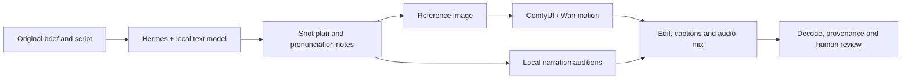

# DGX Spark Media Lab

**A practical Labverse field guide to local video, voiceover and audio workflows with Hermes and ComfyUI.**

Build a small, inspectable media workstation on a Linux NVIDIA DGX Spark with 128 GB unified memory. Start with one image, one moving clip and one short narration; then edit them into an original film. This repository shares what we learned while doing that work at [Labverse](https://labverse.org).

**Research snapshot: 8 November 2026.** The tutorials combine dated local evidence with pinned upstream references. They are a public reconstruction of our private research environment, not an image of our machine or a one-command production appliance. The public helpers pass offline tests; a clean installation of this public edition on another Spark has not yet been demonstrated.

## Three tutorials

| Tutorial | What you will build |
| --- | --- |
| [1 — Spark, local inference and Hermes](tutorials/01-spark-and-hermes.md) | Isolated runtimes, a verified local model route, profiles and a safe media handoff |
| [2 — Images and genuine moving video](tutorials/02-images-and-video.md) | Z-Image reference images, Wan T2V/I2V clips, queue receipts and measured generation |
| [3 — Voiceover, music and a finished film](tutorials/03-voice-audio-and-finishing.md) | Local Indic-Mio narration, voice auditions, an original procedural score, captions and audiovisual QA |

Read [the evidence ledger](docs/TESTED-AND-LIMITATIONS.md) before quoting performance or capabilities. See [troubleshooting](docs/TROUBLESHOOTING.md), [model/license notes](docs/MODELS-AND-LICENSES.md) and [primary sources](docs/SOURCES.md).

## The workflow



Heavy GPU stages run sequentially. In our measured configuration, the text server occupied roughly 99 GiB; keeping that allocation beside Wan inference was impractical. Preserve the text service's configuration, pause it deliberately when necessary, finish media work, release media weights, and verify text inference again. Hermes profiles separate state; they do not create security sandboxes or extra GPU capacity.

## What is included

- Three detailed tutorials and three [launch-post drafts](posts/launch-posts.md).
- A pinned, selective model manifest with expected sizes and publisher hashes where available.
- ComfyUI image, T2V, I2V and export-diagnostic graphs. UI and API formats are separate.
- Small Python helpers for sequential downloads, local-model checks, job receipts, offline speech, original procedural music and final media checks.
- A Hermes skill template for invoking those ordinary local tools.
- Contribution instructions, CI, third-party notices and clear evidence boundaries.

No weights, private recordings, speaker embeddings, account sessions, generated films or internal research archives are distributed. The included speech example uses a zero speaker embedding, an experimental synthetic baseline; it does not reproduce our private preferred voice. You supply your own cleared assets.

## Start here

On the Spark, with Python 3.12+, Git and FFmpeg available:

```bash
git clone https://github.com/Lab-Verse/dgx-spark-media-lab.git
cd dgx-spark-media-lab
python3 scripts/preflight.py
python3 scripts/models.py --group video --root "$HOME/spark-media"  # plan only
python3 -m unittest discover -s tests -v
```

Then follow Tutorial 1 before downloading or starting inference. `models.py` requires `--download --accept-licenses` to write model payloads. The small offline tests do not load models or contact a provider.

## Our observed results

The private research records include a 147.2917-second full-motion Urdu experiment assembled from 30 locally generated Wan clips, and a later 5.0625-second Wan 14B qualification. These are different runs with different parameters, not a general throughput benchmark. A separate later 15-shot portfolio job lost connectivity after nine last-verified sources; its final outcome was unknown at this snapshot.

Urdu pronunciation, longer character consistency, motion direction, lip sync and unattended recovery need their own evaluations. Downloaded models are not automatically runtime-qualified. Optional ACE-Step music models were acquired but not qualified by the cited media tests. Hosted NVIDIA NIM is an explicit optional route; no automatic cloud fallback is configured by this repository.

## Contribute

Please send measured fixes, minimal workflows and reproducible failures. Start with [CONTRIBUTING.md](CONTRIBUTING.md). Never include credentials or identifiable voice references in issues. Use [SECURITY.md](SECURITY.md) for sensitive reports.

Original code and documentation: Apache-2.0, [LICENSE](LICENSE). Derived workflow attribution: [NOTICE](NOTICE). Model weights, auxiliary checkpoints and third-party software retain their own terms. Labverse is an independent contributor; this is not an NVIDIA or Nous Research product.
